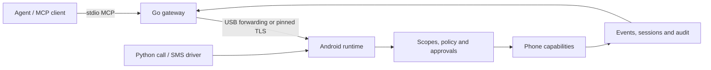

# Android Agent Harness

Give an AI agent a dedicated Android phone: SMS, calls, contacts, notifications, apps, screen interaction, and on-device workflows through typed MCP tools.

The Android app enforces peer scopes, action limits, policy and approvals, and records an audit trail. A Go gateway connects MCP clients or model providers to the phone. Optional Python drivers handle spoken calls and inbound SMS conversations.

**Status:** experimental developer software. Ordinary phone tools and privileged cellular call audio have different setup requirements. Automated tests cover many protocol and failure paths; they do not establish reliability on every phone, carrier or model. See [validation](docs/review.md).

**Use at your own risk.** You are responsible for your agents, their permissions and actions, required consent, and resulting communications, commitments and charges. To the fullest extent permitted by law, the project is provided without warranties and its authors and contributors disclaim liability for its use and agent behavior. Read the [full disclaimer and operator responsibilities](docs/disclaimer.md) before deployment.



## Capabilities

- Read device state, contacts, messages, notifications, calendars, location and supported sensors.
- Send SMS, place/control calls, interact with apps and use accessibility tools when granted.
- Subscribe to journaled events and replay them after a connection interruption.
- Run bounded batches and saved workflows with event or schedule triggers.
- Hold spoken calls with an off-device model and speech services on suitably provisioned devices.
- Answer allowlisted incoming texts with a restricted tool set.

Availability depends on Android permissions, peer scopes, device roles, installed services and firmware. `tools/list` is the authoritative capability list for a paired client.

## Documentation

1. [Build and connect](docs/development.md): prerequisites, builds, USB forwarding and pairing.
2. [Architecture](docs/architecture.md): components, trust boundaries and source map.
3. [Security and privacy](docs/security.md): defaults, permissions, logs and limitations.
4. [Protocol](docs/protocol.md): MCP, event and session contracts.
5. [Automation](docs/automation.md), [spoken calls](docs/conversation-mode.md), and [inbound SMS](docs/inbound.md).

| Directory | Purpose |
| --- | --- |
| `android-runtime/` | Kotlin Android app, Compose controls, Ktor transport, phone integrations |
| `gateway/` | Go MCP server/client, provider adapters, persistent transcript/event state |
| `tools/` | Python drivers, simulations, device checks and publication tools |
| `protocol/schemas/` | JSON Schema contracts and synthetic examples |
| `skills/` | Agent workflow recipes |
| `docs/` | Selected public documentation and review evidence |
| `licenses/` | License texts for bundled third-party components |
| `.github/workflows/` | CI for the offline Go, Python and Android checks |

`PUBLICATION_MANIFEST.json` records SHA-256 hashes of the published file set (see [publishing](docs/publishing.md)).

## Offline checks

```sh
python -m pip install -r tools/requirements.txt
python tools/publication.py check
python tools/test_inbound.py
python tools/test_converse_sim.py
python -m unittest discover -s tools -p 'test_*.py'
cd gateway
go test ./...
go vet ./...
```

CI runs the same checks, with `go test -race ./...` (needs CGo) and an Android job running `bash gradlew testDebugUnitTest lintDebug assembleDebug`. The conversation simulation uses real timing and takes several minutes. See [development](docs/development.md) for Android checks. `dry_call.py` and `judgement_eval.py` contact model services; device verification and SMS mesh scripts contact real phones. They are not offline tests.

## Publishing and contributing

[Publication guide](docs/publishing.md) explains clean export, privacy checks and Git author metadata. [Contributing](CONTRIBUTING.md) covers development checks. Report sensitive findings using [SECURITY.md](SECURITY.md).

## License

Project code is [MIT licensed](LICENSE). Dependencies and bundled third-party assets retain their own licenses; see [third-party notices](THIRD_PARTY_NOTICES.md).
